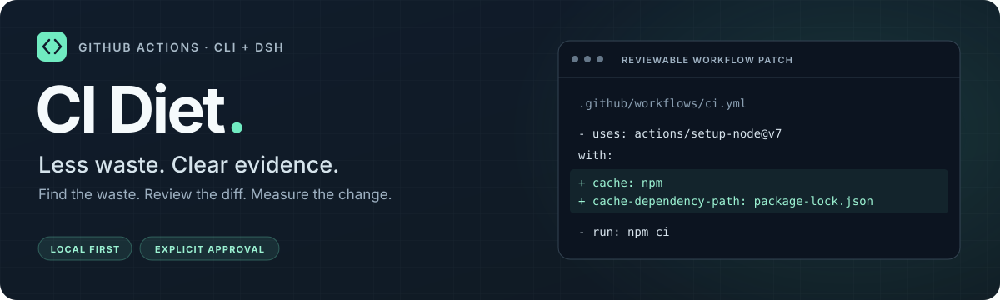
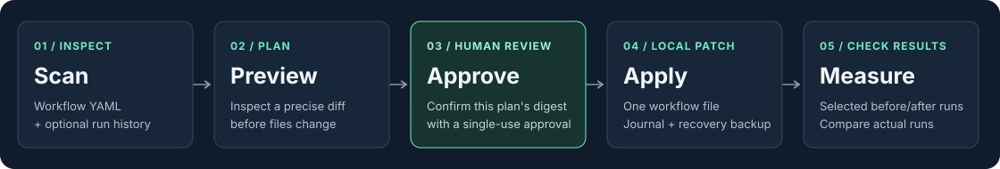
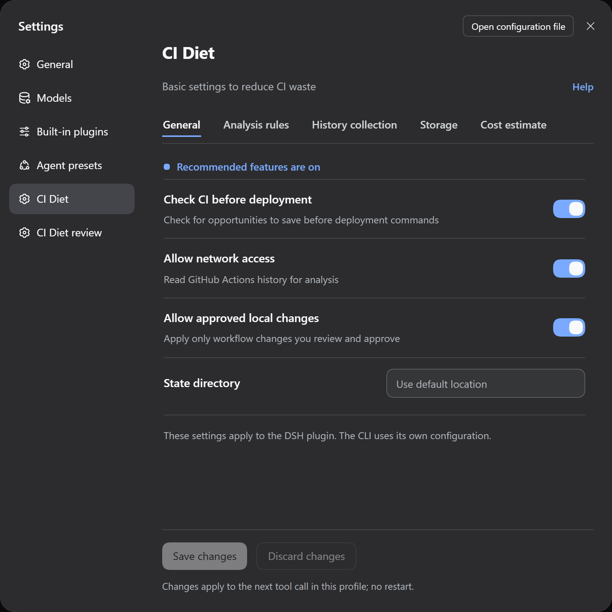

<p align="center"></p>

# CI Diet

[English](README.md) · [한국어](README.ko.md) · [简体中文](README.zh-Hans.md) · [हिन्दी](README.hi.md) · [Español](README.es.md) · [Français](README.fr.md)

<p align="center">
  <a href="https://www.npmjs.com/package/dsh-ci-diet"></a>
  <a href="LICENSE"></a>
  <a href="https://github.com/0disoft/dsh-ci-diet/actions/workflows/ci.yml"></a>
</p>

**Encuentra tiempo de runner de GitHub Actions que probablemente se desperdicia, conserva las pruebas y convierte pequeñas correcciones en planes para revisión humana.**

CI Diet es una CLI y un plugin de DeepSeek Harness (DSH) en fase alpha. Lee definiciones de workflow y, cuando está habilitado, el historial de GitHub Actions; después muestra hallazgos y prepara cambios YAML acotados sin modificar un workflow por su cuenta.

## Instalación

La CLI requiere Node `^22.19.0 || >=24.0.0`. La versión actual en npm es `0.5.2`.

```bash
npm install --global dsh-ci-diet@0.5.2
ci-diet --version
dsh plugin --profile web add dsh-ci-diet@0.5.2
dsh --profile web
```

El plugin registra las herramientas de DSH y las pantallas **Settings → CI Diet** y **Revisión de CI Diet**. Instalarlo por sí solo no analiza un repositorio, no ahorra minutos de runner ni modifica un workflow. Si no instalas la CLI global, usa `npx dsh-ci-diet@0.5.2` en lugar de `ci-diet`.

## Primer scan e historial

Ejecuta estos comandos desde el repositorio que quieres inspeccionar. El escaneo estático funciona sin conexión y guarda su informe. La sincronización del historial es un paso de red aparte que lee ejecuciones y jobs recientes mediante peticiones de solo lectura a la API de GitHub a través de la CLI `gh` autenticada.

```bash
ci-diet scan --cwd .
gh auth status
ci-diet sync --cwd . --network
ci-diet report --cwd .
ci-diet report --cwd . --format html --out report.html
```

`gh` necesita permiso de lectura para las ejecuciones y jobs de Actions del repositorio. CI Diet nunca necesita acceso de escritura a GitHub. El informe HTML es un único archivo autónomo con CSS inline, sin scripts ni peticiones externas. En DSH, `ci_diet_scan` y `ci_diet_sync` guardan informes; los perfiles nuevos del plugin tienen la red y la comprobación previa activas por defecto.



## Lo que detecta

<p align="center">
  
</p>
<p align="center"><sub>Settings → CI Diet configuration. Interfaz en coreano; la comprobación previa está activa por defecto.</sub></p>

| Regla | Por defecto | Busca | Resultado habitual |
| --- | --- | --- | --- |
| CD001 | activa | ejecuciones de PR reemplazadas por un commit más nuevo | plan de `concurrency` |
| CD002 | activa | candidatos de trigger solapados o duplicados | explicación |
| CD003 | desactivada | comprobaciones pesadas para cambios declarados solo de documentación | explicación |
| CD004 | activa | matrices grandes que se pueden resolver estáticamente | nota de revisión |
| CD005 | desactivada | jobs sin timeout | plan medido de `timeout-minutes` |
| CD006 | activa | jobs compatibles de npm, pnpm o Bun frozen install sin caché explícita | plan de caché de descargas |
| CD008 | activa | retención de artifacts más larga de la necesaria | plan de `retention-days` con confirmación humana |

CD003 y CD005 están desactivadas por defecto. CD002, CD003 y CD004 no generan parches. CD005 limita ejecuciones anómalas; no acorta la ejecución normal. CD008 cambia la retención de artifact storage, no los minutos de runner. Todo plan es una hipótesis hasta que lo revisas y mides el resultado.

## Ejemplo de caché npm compatible

CD006 reconoce una forma concreta: un paso `actions/setup-node@v7` compatible seguido de `npm ci`, con un manifest y un lockfile rastreados. El plan solo añade entradas de caché; las versiones, la instalación y las pruebas permanecen igual. El ejemplo supone que `package.json` no declara npm en `packageManager` ni en `devEngines.packageManager`; si npm está declarado, v7 activa la caché automáticamente y CI Diet no propone una caché redundante.

**Antes**

```yaml
jobs:
  test:
    runs-on: ubuntu-latest
    steps:
      - uses: actions/checkout@v7
      - uses: actions/setup-node@v7
        with:
          node-version: 22
      - run: npm ci
```

**Después**

```yaml
jobs:
  test:
    runs-on: ubuntu-latest
    steps:
      - uses: actions/checkout@v7
      - uses: actions/setup-node@v7
        with:
          node-version: 22
          cache: npm
          cache-dependency-path: package-lock.json
      - run: npm ci
```

En un comando plan, `--step 1` significa el segundo paso de este array YAML: checkout es `0` y setup-node es `1`. Es un índice basado en cero, no una etiqueta. Consulta la [guía del plugin](docs/guide/plugin.md) para pnpm, Bun, timeouts, retención y las protecciones actuales.

## Revisar antes de escribir

El flujo es **scan → preview → human approval → apply → measure**. Las herramientas de modelo, incluida `ci_diet_plan`, previsualizan cambios y calculan un plan digest; no pueden aprobar, aplicar ni revertir. La pantalla de revisión permite aprobar, aplicar y revertir después de que una persona escriba el sufijo del plan digest o el change ID. Las escrituras locales son cambios por rangos de bytes en un único workflow existente.

```bash
ci-diet plan --cwd . --rule CD006 --workflow .github/workflows/ci.yml --job test --step 1
ci-diet plans --cwd . --plan PLAN_ID
ci-diet approve --cwd . --plan PLAN_ID --confirm CONFIRMATION
ci-diet apply --cwd . --plan PLAN_ID
ci-diet measure --cwd . --change CHANGE_ID --before-runs 100,101 --after-runs 110,111 --network
ci-diet revert --cwd . --change CHANGE_ID
```

Una aprobación vale solo para ese plan. Aplicar crea una copia de seguridad, reescribe los bytes planificados y comprueba source, dependency, policy, digest, lock y backup. Revertir restaura la copia. CI Diet no hace commit, push ni deploy, no ejecuta workflows, no cambia branch protection y no borra artifacts.

## Evidencia y límites

- No se afirma un ahorro antes de medirlo. Un hallazgo puede ser erróneo si el historial o la atribución del workflow están incompletos.
- La caché de dependencias puede añadir tiempo de restore y save. Su overhead puede superar el tiempo de instalación que evita; compara ejecuciones cold y warm equivalentes e incluye los pasos de caché.
- `measure` compara ejecuciones reales seleccionadas y muestra diferencias observadas de runner time, tasa de éxito y de relanzamiento. Es evidencia sobre esas muestras, no prueba de causalidad ni de la factura real.
- La página Settings guarda la configuración de herramientas y muestra informes y planes ligados a la sesión. No optimiza un workflow por sí misma.
- Las comprobaciones de policy y evidencia pueden bloquear una edición útil. Revisa el informe, el diff y las propias comprobaciones del repositorio antes de conservar un cambio.

| Medida | Significado |
| --- | --- |
| `observedRunnerSeconds` | Tiempo de runner observado en las ejecuciones recopiladas |
| `modeledRoundedMinutes` | Minutos por job redondeados hacia arriba; solo una estimación |
| `listPriceUsd` | Estimación de precio de lista desde la instantánea de precios incluida |
| `actualBilledUsd` | `unknown` hasta poder demostrar una factura real |

Mantener estos valores separados evita que los minutos modelados se conviertan en una afirmación de facturación.

## Documentación

| Necesidad | Leer |
| --- | --- |
| Instalación, ajustes, CLI, revisión y medición | [Guía del plugin](docs/guide/plugin.md) · [Sección de medición](docs/guide/plugin.md#measuring-an-applied-change) |
| Descripción normativa y mapa de contratos | [Índice de especificación](docs/spec/README.md) |
| Protecciones de reglas, modelo de coste, patches y storage | [Reglas](docs/spec/rules.md) · [Modelo de coste](docs/spec/cost-model.md) · [Modelo de patch](docs/spec/patch-model.md) · [Storage](docs/spec/storage.md) |
| Una medición real de overhead de caché | [Revisión de caché del 2026-10-25](docs/measurements/2026-10-25-cache-review.md) |

<details>
<summary>Valores predeterminados, migración y compatibilidad del plugin</summary>

Los perfiles nuevos de DSH activan `preflightEnabled`, `networkEnabled`, `localApplyEnabled` y las reglas CD001, CD002, CD004, CD006 y CD008. La migración única registra `defaultsRevision: 2`; los cambios posteriores de switches y reglas sobreviven a los reinicios. CD003 y CD005 siguen desactivadas hasta activarlas de forma explícita. Las rutas de estado, la retención, las cuotas y las entradas de facturación existentes se conservan.

El plugin admite DSH `>=0.2.1-rc.2 <0.3.0-0` y `>=0.2.2-rc.1 <0.3.0-0`. DSH `0.3.0` no es compatible. La comprobación previa del plugin revisa los comandos de despliegue compatibles antes de ejecutarlos, pero no hace peticiones de red ni cambia archivos y omite shells opacas. El historial de la CLI requiere `--network`; el interruptor de red del plugin solo permite llamadas a `gh` cuando se invoca la herramienta de sync. Actualiza con los mismos comandos y `@latest`, después reinicia DSH.

</details>

## Contribuir y licencia

Los informes de errores y propuestas concretas son bienvenidos en [GitHub Issues](https://github.com/0disoft/dsh-ci-diet/issues). Antes de cambiar reglas o contratos, lee la [guía del plugin](docs/guide/plugin.md) y las [decisiones](docs/spec/decisions.md). Las especificaciones detalladas y la documentación pública están en inglés.

MIT © Rodisoft
